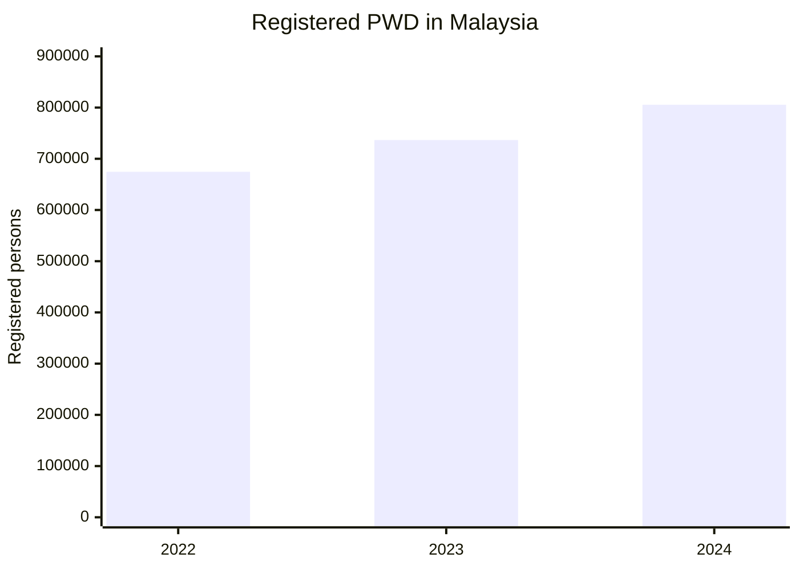
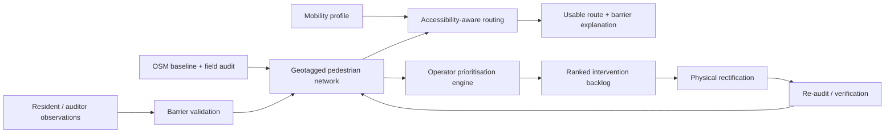
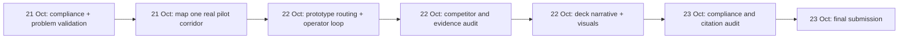

# Deep Research Report: Sime Darby Property University Hackathon 2026 — PEOPLE Theme

## Executive Summary

The original user request text is unspecified. I therefore treat the uploaded research mandate for the **Sime Darby Property University Hackathon 2026 — PEOPLE theme** as the intended subject, while distinguishing its assumptions from independently verified facts. The brief seeks a defensible project that a 3–5-person university team can propose by 23 October 2026 and, if shortlisted, build into a credible prototype. fileciteturn0file0

The official competition page confirms that teams must contain **3–5 students**, at least one member must be able to code, proposal submission is scheduled for **23 October 2026**, the Top 10 announcement for **28 October**, final submission for **11 November**, Top 10 pitch day for **14 November**, and final presentation/awards for **3 December 2026**. The official scoring weights are Impact & Sustainability Value 25%, Innovation & Differentiation 20%, Feasibility & Deliverability 20%, Strategic Fit & Theme Relevance 15%, Commercial & Value Multiplication 10%, and Team, Evidence & Pitch Quality 10%. citeturn17search0

The strongest opportunity found is **not** a generic resident app, chatbot, social platform or “smart-city super-app”. Sime Darby Property already has a substantial digital owner/resident ecosystem: its main app covers property information, construction progress, documents, defect reporting and household-member management, while PRIME functionality supplies benefits, events and community content. That makes another broad resident application difficult to differentiate convincingly. citeturn17search2turn17search3turn17search5

Instead, three narrower opportunities stand out:

| Rank | Concept | Primary PEOPLE area | Analytical score | Differentiation | MVP feasibility | Principal risk |
|---|---|---|---:|---|---|---|
| **1** | **AccessLoop** | Accessibility & Inclusion | **85.5/100** | Moderate–high at workflow level | High | Reliable ground-truth accessibility data |
| **2** | **CoolLink** | Healthy Lifestyles / Mobility | **82.6/100** | Moderate | High–moderate | Thermal/shade-model fidelity |
| **3** | **SafeCross Audit** | Safety & Security | **77.7/100** | Low–moderate | Moderate | Crowded market, video/privacy and hardware requirements |

These are independent analytical scores using the organiser's published weighting; they are **not** Sime Darby Property scores. citeturn17search0

**Recommended project: AccessLoop.** It would create a mobility-profile-aware pedestrian network for a selected township area, identify obstacles such as inaccessible kerbs, steep grades, missing/blocked paths and unsuitable crossings, generate routes appropriate to an individual user's mobility needs, and—critically—convert the same data into a prioritised accessibility-improvement queue for township management. Its core proposition is therefore **not “Google Maps for wheelchairs”**; comparable accessible-routing technology already exists. The differentiator is a closed operational loop connecting **audit → personalised route → infrastructure-priority decision → rectification → re-audit** within a township that one operator can actually improve. AccessMap, OpenSidewalks and Project Sidewalk demonstrate that personalised pedestrian networks, crowdsourcing and machine-assisted accessibility mapping are technically credible, while also demonstrating that routing alone cannot be claimed as novel. citeturn19search2turn19search3turn19search8

City of Elmina is the strongest pilot environment identified. Sime Darby Property already positions it around wellness and inclusion, built Malaysia's first Inclusive Playground there with UNICEF using universal-design principles, is developing a 15-minute-city model around Elmina City Centre, and operates a high-footfall mall connected to a 35-acre urban park. This creates a particularly coherent story: **extend inclusion from an accessible destination to the journeys between destinations**. citeturn16search1turn17search9turn17search1

The strongest competitive advantage is therefore **operator actionability**: AccessLoop can give residents better information while simultaneously telling the township operator which physical barrier, if rectified, unlocks the most useful accessible connections. Its biggest vulnerability is equally clear: without field-validated pedestrian data and input from people with disabilities, the team risks presenting an elegant algorithm built on unreliable assumptions.

One major non-technical issue requires immediate attention. The official Terms & Conditions state that intellectual-property rights in Participant Submissions and Developed IP created in connection with the programme vest in or are assigned to Sime Darby Property, with broad perpetual, worldwide, transferable and sublicensable rights; incorporated Background IP also attracts a broad licence where necessary for use of the submission. Material use of AI tools must be disclosed, and third-party code, APIs, datasets and other materials must be properly licensed. citeturn22search0turn22search1

Finally, an important submission-compliance gap remains. The uploaded mandate asks for exact verification of **four mandatory proposal components**, a possible **10-slide restriction**, whether appendices count, the deadline time and upload/file-format requirements. I attempted the referenced briefing through the connected Google Drive account, but it returned a 403 restriction. Those briefing-specific requirements therefore remain **UNVERIFIED — briefing element inaccessible**. They should not be invented from the public FAQ. The public page verifies the date and evaluation structure, but not those briefing-slide details. citeturn17search0

## Scope, Objectives and Method

### Scope and assumptions

The research objective adopted here is: **identify the strongest evidence-backed PEOPLE-theme project direction for a technically capable Malaysian university team, with emphasis on reaching the Top 10 while retaining a believable pathway to an actual Sime Darby Property pilot**. The team capabilities, two-day proposal constraint and desired ideation funnel originate in the uploaded working specification rather than an independently stated user query. fileciteturn0file0

The geographic emphasis is Malaysia, especially Klang Valley/Selangor and Sime Darby Property townships. The competitive lens is international because genuinely differentiated accessibility, pedestrian-safety and thermal-routing technologies already exist overseas; Malaysian novelty cannot responsibly be assessed without testing the idea against those systems.

### Research methodology

The evidence hierarchy was deliberately asymmetrical:

| Evidence class | Sources used | Role in analysis |
|---|---|---|
| **Competition rules** | Current Sime Darby Property hackathon site and official T&C | Source of truth |
| **SDP strategic fit** | Official SDP township, app and press-release pages | Pilot and redundancy analysis |
| **Malaysian need** | DOSM, Ministry of Transport and other official public sources | Problem magnitude and policy context |
| **Technical feasibility** | Peer-reviewed journals, university research programmes and official technical documentation | Mechanism/prior-art validation |
| **Commercial competition** | Vendors' own official sites | Establish claimed capabilities only, not independent proof of impact |

The research searched current official web material and recent peer-reviewed/primary academic material, especially work published from 2024–2026. Technical claims were grounded primarily in original papers, official project documentation and official API documentation rather than secondary technology blogs. For a subsequent publication-grade literature review, the search should additionally be reproduced systematically in **Scopus, Web of Science, IEEE Xplore and ACM Digital Library**, with documented search strings and inclusion/exclusion criteria; the present investigation did not claim comprehensive coverage of every record in those subscription databases.

A critical methodological distinction is between **technology novelty** and **solution novelty**. For example, personalised accessible routing is already real, thermal-aware pathfinding is an active research field, and computer-vision near-miss detection is already sold commercially. Consequently, this report does not treat “we use AI” or “we calculate a better route” as sufficient differentiation. citeturn19search2turn18search1turn20search4

### Competition requirements that are verified

The official website defines the pitch through two concepts. **Mechanism** concerns what the solution does, how it works, who benefits and why it creates township value. **Enabler** concerns how technology makes the solution possible, improves the user experience and supports township-scale implementation. That distinction strongly favours projects where a real-world process visibly changes, rather than technology demonstrations searching for a use case. citeturn17search0

| Requirement | Status | Evidence |
|---|---|---|
| Team size 3–5 | **Verified** | Official competition site citeturn17search0 |
| At least one teammate able to code | **Verified** | Official competition site citeturn17search0 |
| One selected track | **Verified** | Official FAQ warns against duplicate multi-track submissions citeturn17search0 |
| Proposal submission: 23 Oct 2026 | **Verified** | Official timeline citeturn17search0 |
| Top 10: 28 Oct 2026 | **Verified** | Official timeline citeturn17search0 |
| Mentoring: 2–6 Nov | **Verified** | Official timeline citeturn17search0 |
| Final submission: 11 Nov | **Verified** | Official timeline citeturn17search0 |
| Top 10 pitch: 14 Nov | **Verified** | Official timeline citeturn17search0 |
| Final presentation/awards: 3 Dec | **Verified** | Official timeline citeturn17search0 |
| Four mandatory proposal components | **Unverified** | Referenced briefing inaccessible |
| Maximum ten slides / appendix treatment | **Unverified** | Referenced briefing inaccessible |
| Exact submission deadline time | **Unverified** | Public page establishes date, not a time citeturn17search0 |
| Exact upload format/naming convention | **Unverified** | Briefing required |
| AI-use disclosure | **Verified** | T&C Clause 13 citeturn22search1 |

The scoring weights total 100%:

\[
S=0.25I_m+0.20I_n+0.20F+0.15S_f+0.10C+0.10P
\]

where \(I_m\) is Impact, \(I_n\) Innovation, \(F\) Feasibility, \(S_f\) Strategic Fit, \(C\) Commercial/Value Multiplication and \(P\) Team/Evidence/Pitch. These weights are published by SDP itself. citeturn17search0

## Key Evidence and Opportunity Landscape

### Accessibility is a substantive Malaysian problem, not a niche embellishment

DOSM recorded **805,509 registered persons with disabilities in 2024**, equal to 2.4% of Malaysia's population. Physical disabilities accounted for 286,634 registrations, learning disabilities 299,128 and visual disabilities 68,665. The administrative count was 736,607 in 2023 and 674,548 in 2022. These figures are registrations rather than a full epidemiological estimate, so their increase should **not** be interpreted as proof that disability prevalence itself rose by the same amount. citeturn16search0turn16search15turn24search0

Source: Department of Statistics Malaysia, *Person With Disability Statistics, Malaysia* for 2022, 2023 and 2024. citeturn24search0turn16search15turn16search0

A route-planning gap is technically plausible as well. Google's current Routes API explicitly warns that walking routes are in beta and can omit clear sidewalks or pedestrian paths. The University of Washington's AccessMap shows why a richer network matters: its routing can vary by maximum slope, raised kerbs/stairs, street exposure and mobility profiles, while OpenSidewalks models characteristics such as width, surface, steepness and shared traffic. citeturn19search0turn19search2turn19search10

The strongest lesson from overseas prior art is not “build AccessMap in Malaysia”. It is that **pedestrian data quality is the difficult asset**. Washington's statewide OS-CONNECT project combines machine learning with human vetting, and the data serves both travellers and public-sector planners seeking to identify deteriorated or missing infrastructure. citeturn19search3turn19search5

This aligns unusually well with SDP's existing position in Elmina. The company and UNICEF co-designed the Inclusive Playground with children with and without disabilities, families, disability organisations and specialists, explicitly applying universal-design principles and Malaysian Standard 1184. citeturn16search1

**Inference:** that history makes an accessibility project easier to position strategically than a generic “smart city” feature. It lets the proposal argue for continuity with an existing SDP inclusion commitment rather than asking judges to accept an entirely new corporate agenda. citeturn16search1

### Heat-aware active mobility is scientifically credible but increasingly crowded academically

Recent research strongly supports the premise that shortest walking routes are not necessarily the most thermally comfortable. A 2025 *Sustainable Cities and Society* study generated more than 2.2 million routes across 1,200 origin–destination pairs in subtropical Hong Kong; thermally optimised routes performed better than shortest paths for 81% of those pairs, with mean thermal discomfort 9% lower. Crucially, it found that simple shade-only routing was insufficient, strengthening the case for thermal modelling rather than a crude “walk under trees” algorithm. citeturn18search0turn18search2

A 2025 *Transactions in GIS* study likewise found that shade-aware routing could reduce solar exposure with relatively small detours, while emphasising that navigation alone cannot replace planning interventions such as additional urban shade. citeturn18search4

There is relevant Malaysian evidence. A 2024 modelling study of George Town simulated street-tree interventions and estimated UTCI reductions of roughly 3–7°C depending on street orientation and tree configuration. Those are **modelled microclimate results**, not measured reductions in illness or increases in walking behaviour, so a hackathon proposal should not turn them into unsupported health claims. citeturn25search4turn25search7

City of Elmina again offers a particularly coherent context: Kanopi Residences is explicitly framed around a 15-minute-city model and sits 300 metres from Elmina Lakeside Mall; the mall integrates retail, recreation, community space and a 35-acre adjoining urban park. citeturn17search9turn17search1

**Inference:** the stronger CoolLink proposal is therefore not a standalone “coolest route” app. It is a combined **resident-routing plus capital-planning tool**: identify high-use links where heat exposure makes walking uncomfortable, then let SDP compare shade, trees, covered walkways or resting-point interventions. That dual use matches recent academic recommendations to combine route guidance with street-renewal prioritisation. citeturn18search1turn18search7

### Pedestrian safety is high-impact but technologically crowded

Malaysia's Road Safety Plan 2022–2030 targets a **50% reduction in road deaths by 2030**, and the Ministry of Transport describes road accidents as one of the country's leading causes of death. citeturn16search10

Computer-vision analysis of vehicle–pedestrian conflicts is technically mature enough for a student demonstration. A 2024 *Journal of Safety Research* study analysed 112 hours of crossing video and used computer vision to extract trajectories and evaluate surrogate safety measures including Post-Encroachment Time and Relative Time to Collision. A 2026 study similarly used object detection and tracking to derive PET at an intersection. citeturn20search0turn20search10turn20search1

The problem for hackathon differentiation is the commercial landscape. Derq already markets detection and analysis of near misses, crashes, pedestrian movements, speeds, counts, TTC/PET and safety heatmaps; VivaCity advertises computer-vision road-user classification, paths, near misses, speeds and turning counts. These are vendor capability claims, not independent proof that either system solves every Malaysian deployment problem, but they make it difficult to claim that camera-based conflict analytics itself is novel. citeturn20search4turn20search13turn20search9

Accordingly, SafeCross should be retained as a credible backup, not the lead. Its societal problem is strong, but the hackathon would have to differentiate on **low-cost temporary audits, privacy-by-design, Malaysian deployment conditions or an SDP-specific intervention workflow**, rather than computer vision itself.

### Generic digital-living and community applications show less white space

SDP already offers a digital property platform that handles owner records, e-documents, construction progress, vacant possession, defect reporting and household-member access. PRIME's features have been incorporated into the newer app, alongside events, benefits and community information. citeturn17search2turn17search3turn17search5

This does not prove that no digital-living problem remains unsolved. It does mean that a proposal labelled “AI township assistant”, “one app for residents”, “community event discovery” or “smart defect-reporting system” starts with a substantial differentiation burden. **The safer competitive strategy is to solve a specialist problem the existing app does not appear designed to solve and, eventually, integrate the result rather than compete with SDP's platform.** citeturn17search2turn17search3

## Comparative Findings and Contrasting Viewpoints

The three finalists survive for different reasons, and none dominates every criterion.

| Criterion | **AccessLoop** | **CoolLink** | **SafeCross Audit** |
|---|---:|---:|---:|
| Impact, 25% | 8.8 | 8.4 | **8.9** |
| Innovation/differentiation, 20% | 7.6 | **7.8** | 6.2 |
| Feasibility/deliverability, 20% | **8.8** | 8.0 | 6.8 |
| Strategic fit, 15% | **9.4** | 9.2 | 8.8 |
| Commercial/value multiplication, 10% | 8.1 | 7.8 | **8.2** |
| Team/evidence/pitch, 10% | **8.5** | 8.4 | 8.0 |
| **Weighted score** | **85.5** | **82.6** | **77.7** |

The calculation for AccessLoop, for example, is:

\[
(8.8\times25 + 7.6\times20 + 8.8\times20 + 9.4\times15 + 8.1\times10 + 8.5\times10)/10
=\mathbf{85.5}
\]

The weights come from the organiser; the 0–10 evaluations are this report's evidence-based judgement. citeturn17search0

### Why AccessLoop ranks first

**Case for it.** Malaysian administrative data establishes a sizeable disability constituency; mainstream walking directions acknowledge missing pedestrian-path information; mature research systems prove that profile-specific routing can be built; and Elmina gives SDP an existing inclusion narrative against which to pilot the idea. Unlike a project dependent on proprietary resident records or permanent CCTV, a prototype can begin with OpenStreetMap plus a manually audited demonstration zone. citeturn16search0turn19search0turn19search2turn16search1

**Case against it.** The underlying concept of accessible routing is emphatically not new. AccessMap already personalises routes; OpenSidewalks already defines detailed pedestrian data; Project Sidewalk already uses crowdsourcing and computer vision for accessibility mapping. A pitch claiming “AI-accessible navigation” as the innovation would therefore be weak. citeturn19search2turn19search10turn19search8

The project only becomes competitively interesting when the **mechanism** changes from navigation to infrastructure management: a barrier report should change the pedestrian graph, affect route availability, enter an operator priority model, trigger or support remediation, and then be revalidated. That end-to-end loop is the proposal's central hypothesis and should be presented honestly as a **deployment/workflow innovation built from established technical components**, not as invention of accessible routing.

### Why CoolLink nearly wins

**Case for it.** It provides an immediately visual demo; it fits Elmina's walkability/wellness and 15-minute-city positioning unusually well; the optimisation can be technically substantive without requiring a large ML model; and research shows that thermal route choice and infrastructure prioritisation can complement each other. citeturn17search9turn18search1turn18search7

**Case against it.** The research frontier is moving quickly. Thermal-comfort and shade-aware routing already appears in peer-reviewed work and 2026 prototypes, so the team cannot credibly present a “cool route” algorithm as unprecedented. High-quality modelling also depends on information about buildings, trees, solar exposure and local microclimate; a two-day proposal can design this, but a strong prototype would need to be explicit about where it uses proxies rather than measured UTCI. citeturn18search4turn18academia15

A particularly useful contrary finding is that **shade alone can be a poor optimisation target**: the Hong Kong study found thermal optimisation superior to simple shade-based routing. This argues against an attractive but technically simplistic pitch built around counting tree canopy pixels. citeturn18search1

### Why SafeCross falls to third

**Case for it.** It addresses a serious policy problem, near-miss analysis can provide proactive information without waiting for crashes to accumulate, and contemporary computer vision can extract suitable surrogate safety measures from video. citeturn16search10turn20search0

**Case against it.** The commercial prior art is much stronger than for the operator version of AccessLoop. Existing suppliers already market essentially the core feature set. A credible real-world pilot also creates harder questions about cameras, consent/privacy, field positioning, calibration, data retention and whether the prototype demonstrates more than an off-the-shelf object detector. citeturn20search4turn20search9

### Why not a community/social/AI assistant concept?

A neighbourhood-matching or resident-AI concept could be quicker to code, but fast implementation is not the same as high feasibility under the judging rubric. Where an organiser already has an owner application and community platform, a second digital layer risks scoring adequately on deliverability but poorly on differentiation and strategic necessity. citeturn17search2turn17search5turn17search0

## Recommended Project and Design Implications

### AccessLoop: accessible journeys plus an infrastructure-improvement loop

**Problem statement:** People with different mobility needs cannot infer from a conventional pedestrian map whether the complete route between township destinations is actually usable; at the same time, township management lacks a continuously updated, trip-oriented way to identify which accessibility barriers are most consequential.

**Primary user:** wheelchair users and other mobility-impaired pedestrians. The system can later support stroller users, older adults, cane users and other mobility profiles, but the first proposal should resist trying to solve every form of disability simultaneously. AccessMap's own architecture illustrates why different mobility needs require different routing preferences. citeturn19search2

**Pilot hypothesis:** begin with a compact City of Elmina corridor connecting destinations such as the inclusive playground, Central/Urban Park, Elmina Lakeside Mall and the emerging City Centre. This is an inference about pilot suitability, supported by Elmina's existing inclusion infrastructure, walkability strategy and connected public destinations. citeturn16search1turn17search1turn17search9

**Mechanism:** change how accessibility barriers are identified and acted upon. Instead of complaints existing as isolated tickets, every validated barrier alters a pedestrian network and its affected routes. The operator can then prioritise remediation based on barrier severity and network significance.

**Technology enabler:** a geospatial graph stores path and crossing attributes; routing weights change by mobility profile; smartphone observations and optional computer vision assist classification; an operator model ranks barriers according to agreed criteria; the same network is recomputed after rectification.

A credible student stack would be **MapLibre or Leaflet + React/Next.js**, a **PostgreSQL/PostGIS** backend, OpenStreetMap/OpenSidewalks-compatible geometry, and a graph algorithm such as weighted Dijkstra or A*. Computer vision should be optional and narrow: for example, assisting—but not autonomously certifying—classification of a kerb, obstruction or surface problem. OpenSidewalks shows that the important pedestrian attributes can be represented explicitly, while AccessMap demonstrates graph-based personalised use of those attributes. citeturn19search4turn19search10

The routing objective could be formulated as:

\[
\min_R \sum_{e\in R}
\left[
d_e+
\lambda_1 b_e+
\lambda_2 s_e+
\lambda_3 c_e+
\lambda_4 q_e
\right]
\]

where \(d_e\) represents distance, \(b_e\) barrier cost, \(s_e\) slope cost, \(c_e\) crossing risk/penalty and \(q_e\) a data-quality uncertainty penalty. For an impossible constraint—such as stairs for a wheelchair profile—the edge should be excluded rather than merely made expensive. This is a proposed implementation, not a result already validated in Elmina.

The **operator intelligence** is at least as important as routing. A simple initial intervention-priority score could combine severity, number of affected destination connections, estimated affected route demand, availability of alternatives and evidence confidence. The proposal should **not** invent resident usage numbers to populate it. Demonstrate the calculation on clearly labelled synthetic demand or a small manually surveyed corridor and make real demand calibration a pilot requirement.

### What is novel and what is not

| Element | Novelty assessment |
|---|---|
| Accessibility-aware routing | **Not novel** — direct prior art exists citeturn19search2 |
| Open pedestrian-network attributes | **Not novel** — OpenSidewalks exists citeturn19search10 |
| Crowdsourced accessibility mapping | **Not novel** — Project Sidewalk exists citeturn19search8 |
| ML-assisted pedestrian mapping | **Not novel** — OS-CONNECT uses ML plus human vetting citeturn19search5 |
| Generic defect ticketing | **Not novel / strategically weak** — SDP's own app already supports defect reports citeturn17search2 |
| **Trip-aware barrier prioritisation tied to an SDP-managed township and followed through to rectification/re-routing** | **Differentiation hypothesis worth testing** |
| **Extending Elmina's physical inclusion strategy from destinations to the connecting pedestrian network** | **Strong SDP-specific positioning hypothesis** citeturn16search1 |

That honesty improves rather than weakens the pitch. Under a judging framework that explicitly rewards both differentiation and feasibility, a novel operating mechanism built on proven technical components may be more defensible than claiming a brand-new AI algorithm. citeturn17search0

### The strongest 90-second demonstration

The demo should show **one concrete accessibility failure**, not a large application.

A wheelchair profile requests a route between two Elmina destinations. The nominal shortest path contains an audited obstacle, so the system explains why that segment is unsuitable and selects an accessible alternative. An auditor then records a barrier with a photograph/location; after validation, the graph updates and the operator dashboard shows how that barrier disrupts one or more connections. Finally, a simulated “rectified” state removes the constraint and recomputes the route.

That demonstrates the full mechanism without pretending that the team has mapped an entire township.

### Pilot KPIs

The proposal should define measurement rather than invent improvement percentages. Useful pilot KPIs include **percentage of pilot pedestrian links with verified accessibility attributes; route-feasibility agreement between the system and mobility-impaired testers; number/share of reported barriers verified; time from validated barrier to disposition; change in accessible network reach after selected fixes; and user-reported route confidence/usability**. No improvement should be claimed until tested.

The project's hardest question is not model accuracy; it is **whose judgement certifies accessibility**. SDP's Inclusive Playground was created with critical end-users and disability organisations, which is a strong precedent for co-design. The same principle should govern AccessLoop: people with disabilities should help define barrier severity and validate the pilot rather than appearing only as beneficiaries in the deck. citeturn16search1

### Intellectual-property and licensing implications

The T&C materially affect implementation strategy. Participants warrant that submissions are original or lawfully licensed; third-party software, datasets and APIs must carry sufficient rights; material AI use must be disclosed; Developed IP is assigned to SDP; and relevant Background IP incorporated into the submission may be subject to a broad licence. citeturn22search0turn22search1

Therefore, before submitting code or architecture, the team should maintain a short **dependency/IP register** listing every external dataset, model, library, icon/image and API, its licence, and whether it is Background IP or newly developed work. The team should not assume that code written before the hackathon remains unaffected merely by calling it “background IP”; the actual licence clause should be read carefully before incorporating reusable proprietary assets. citeturn22search1

## Implications for the Proposal

The research points towards a pitch strategy built around **one journey, one user, one broken link and one operator decision**.

City of Elmina supplies unusually strong narrative coherence. It already has an Inclusive Playground, wellness-oriented development, extensive parks, a growing City Centre and a 15-minute-city residential proposition. Elmina Lakeside Mall was described by SDP in June 2026 as part of an integrated walkable ecosystem linking retail, community, recreation and nature; it had achieved full occupancy within eight months and serves a reported catchment of approximately one million residents. citeturn16search1turn17search1turn17search9

The proposal thesis can therefore be framed:

> **Elmina has inclusive destinations. AccessLoop asks whether every resident can complete the journey between them—and gives township management a data-driven way to remove the barriers that prevent it.**

That is a positioning statement, not a claim that Elmina is currently inaccessible.

A sensible ten-slide *working* outline is shown below, but it must **not be treated as evidence that ten slides are officially permitted** until the briefing is retrieved.

| Working slide | Message |
|---|---|
| Hook | “An inclusive destination is not truly inclusive if the journey to it breaks.” |
| Problem | Ordinary pedestrian maps do not encode every mobility-critical barrier |
| User | One concrete wheelchair-user journey; Malaysian PWD context |
| Why Elmina / why SDP | Inclusive Playground + walkable/wellness strategy |
| Solution | AccessLoop in one screen/story |
| Mechanism | Audit → route → prioritise → repair → verify |
| Technology enabler | Graph model, geospatial data, profile-based optimisation, validation |
| Prior art and differentiation | Explicitly acknowledge AccessMap/OpenSidewalks; show operator-loop distinction |
| Impact and pilot | KPIs, compact Elmina corridor, co-design/validation |
| Feasibility and close | What exists by Top 10, what needs SDP support, decision ask |

The most important slide may be the prior-art slide. The team should proactively say that accessible routing exists overseas. Doing so neutralises a likely judge objection and focuses attention on the actual innovation hypothesis.

The second most important slide is feasibility. A full production accessibility map would require substantial data collection and validation. A student team does **not** need to pretend otherwise. The credible Top-10 MVP is a **small, meticulously mapped test network** with perhaps a handful of route scenarios and a working operator feedback loop, not thousands of automatically detected obstacles.

The biggest strategic implication of the judging weights is that **65% of the published score lies in Impact, Innovation and Feasibility combined**. A visually polished chatbot that is easy to build but weakly differentiated is therefore structurally less attractive than a narrower system whose impact mechanism and deployability can both be defended. citeturn17search0

## Recommendations and Immediate Next Steps

**Primary recommendation — AccessLoop.** Proceed unless rapid field/user validation reveals that the proposed barrier-prioritisation mechanism is either unwanted by target users or operationally irrelevant to SDP. Its combination of problem evidence, low initial hardware dependency, geospatial/algorithmic depth, direct connection to Elmina's inclusion strategy and visible operator value gives it the best overall balance.

**Backup A — CoolLink.** Use this if accessibility co-design cannot be obtained or if preliminary mapping reveals no credible data path. It is the safer technically demonstrable concept: optimisation and geospatial modelling can be shown without collecting sensitive personal data, while Elmina's 15-minute/wellness positioning gives it strong strategic fit. Its weakness is growing prior art, so the operator infrastructure-prioritisation layer is essential. citeturn17search9turn18search1

**Backup B — SafeCross Audit.** Retain this when the team has especially strong computer-vision expertise and can identify a specific SDP crossing problem. Do not pitch generic “AI CCTV”; commercial systems already make highly similar claims. citeturn20search4turn20search9

The immediate work should be validation rather than adding features.

| Priority | Action before 23 October | Decision it resolves |
|---|---|---|
| **Critical** | Obtain the 37-page briefing through a team member/organiser-accessible copy and visually inspect the submission slide | Four mandatory components, slide limit, deadline time, file rules |
| **Critical** | Read current T&C as a team and inventory background/third-party IP | Prevent avoidable licensing/IP problems citeturn22search0turn22search1 |
| **Critical** | Map one proposed Elmina journey manually using OSM plus observable pedestrian features | Can AccessLoop be demonstrated honestly? |
| **Critical** | Speak to even a small number of genuinely relevant accessibility stakeholders where practicable; report these as exploratory conversations, not “research proof” | Are the assumed barrier priorities correct? |
| **High** | Build clickable/working routing demo over the small audited graph | Demonstrates technical mechanism |
| **High** | Create operator screen showing barrier criticality and before/after network effect | Demonstrates SDP value |
| **High** | Produce a competitor slide naming AccessMap/OpenSidewalks/Project Sidewalk | Prevents novelty overclaim |
| **High** | Define baseline and pilot KPIs without fabricated uplift | Strengthens impact score |
| **Lower** | Add CV barrier classification | Only valuable if the core graph/feedback loop already works |
| **Defer** | Full township coverage, production mobile app, automated infrastructure recognition | Build only if shortlisted |

Using the research brief's assumed 21–23 October execution window, the work sequence should be:

The most valuable division of labour is by **evidence, mechanism and communication**, rather than giving every member a separate app feature. For a three-person team: one member owns problem evidence/co-design/competitors, one owns geospatial architecture and prototype, and one owns SDP fit, KPIs and deck integration. With four, separate UI/data visualisation. With five, add an independent red-team/compliance owner who checks sources, licences, T&C, pitch logic and unsupported claims.

Several evidence gaps must remain explicit in the proposal:

**UNVERIFIED — briefing element inaccessible:** the four mandatory proposal components, exact slide/page rule, appendix treatment, deadline time and upload/naming requirements.

**UNKNOWN:** the actual completeness of pedestrian accessibility data within the selected Elmina pilot corridor.

**HYPOTHESIS TO VALIDATE:** users with mobility impairments will find profile-specific barrier information valuable enough to alter route choice.

**HYPOTHESIS TO VALIDATE:** SDP's township-management teams would prefer intervention prioritisation based on network accessibility impact over—or alongside—existing defect-management approaches.

**NOT YET MEASURED:** any improvement in accessibility, walking participation, resident satisfaction, maintenance efficiency or township attractiveness attributable to AccessLoop.

The final decision is therefore not that AccessLoop is “proven”. It is that, among the researched directions, it offers the strongest **defensible hackathon proposition**: a nationally relevant PEOPLE problem; an unusually coherent Sime Darby Property pilot environment; substantive but buildable geospatial optimisation; no dependence on privileged resident databases or permanent new hardware; and a clear real-world mechanism linking resident experience to an action that a township operator can take. Its best chance of reaching the Top 10 comes from **underclaiming the novelty of its component technologies and over-delivering on the clarity of the closed-loop mechanism**. citeturn16search0turn16search1turn19search2turn19search5turn17search0